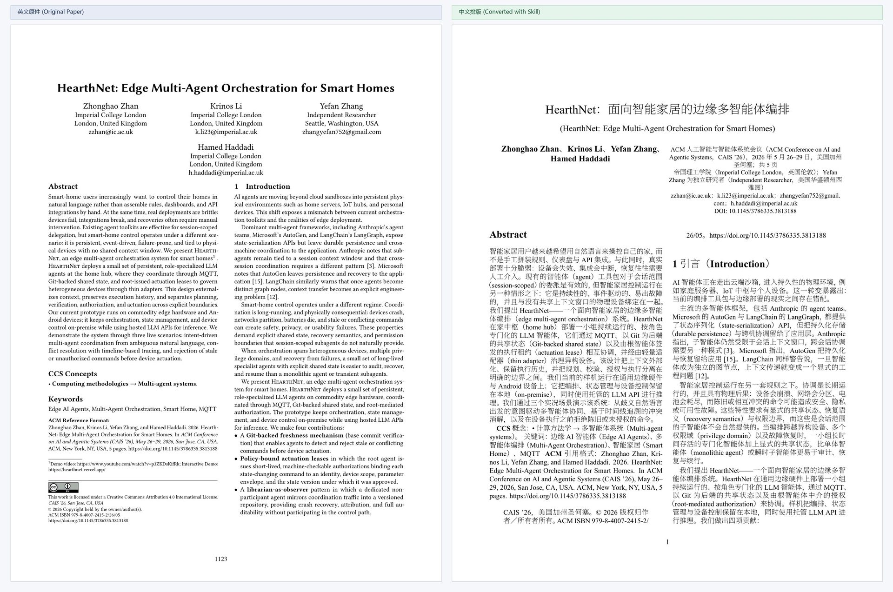
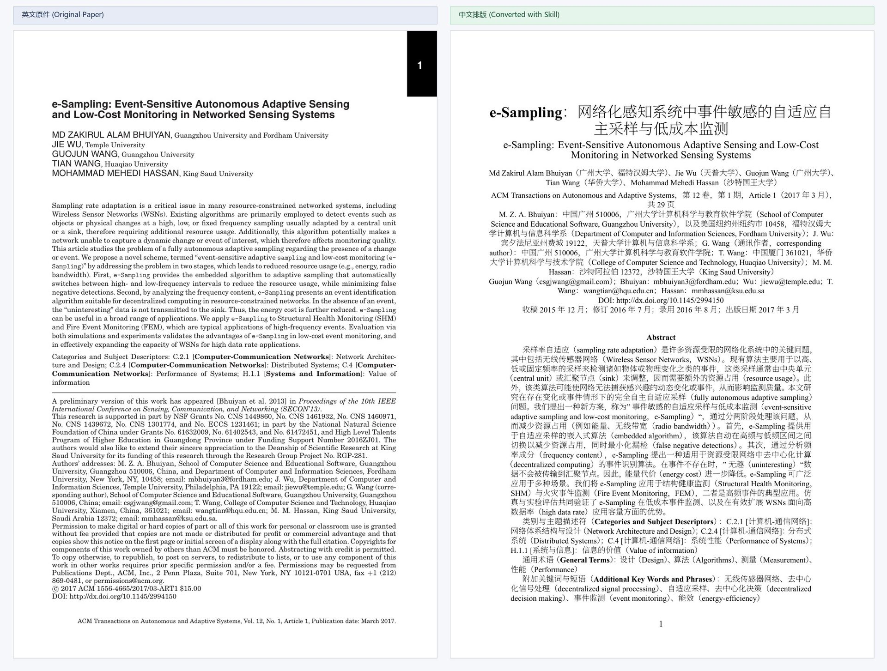
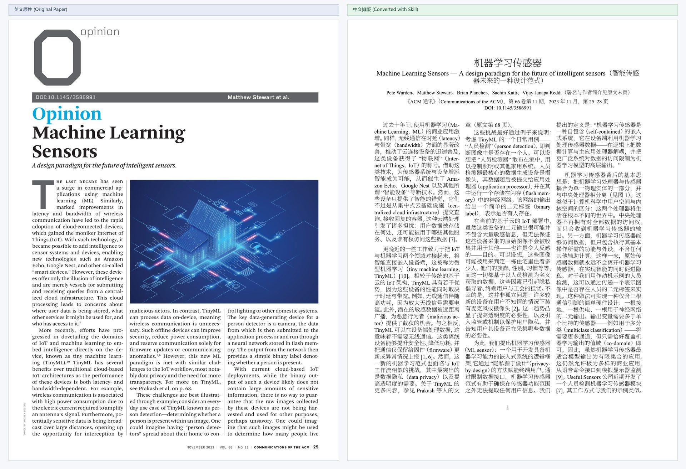
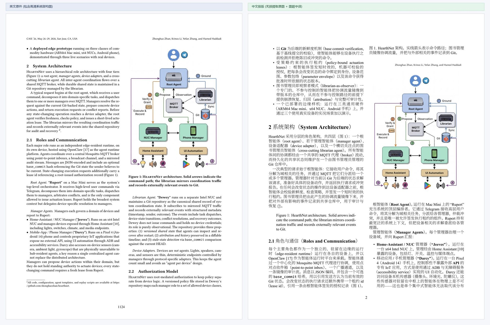
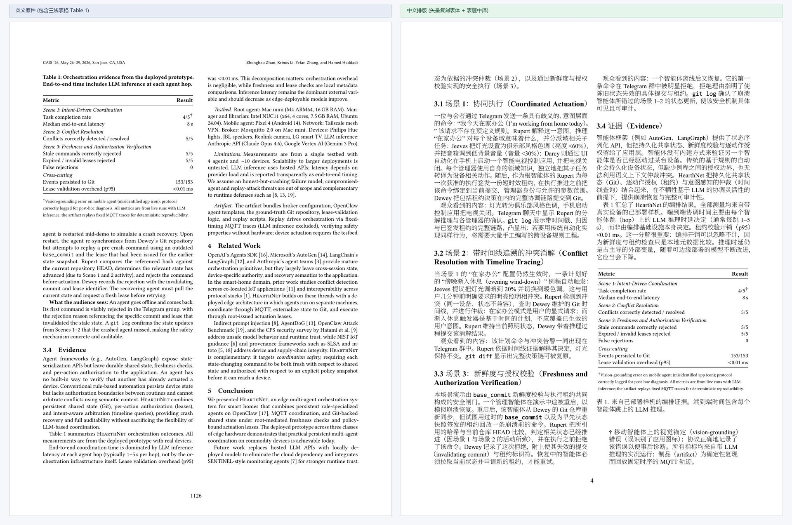

# en-zh-paper-convert — 英文论文 → 中文论文（格式保留）

> **英文论文 PDF 转格式保留的中文论文 PDF**：单/双/三栏、纸张尺寸与边距逐篇照原件，插图原生直取，表格矢量切片复刻，带硬门控质检。遵循 [agentskills.io](https://agentskills.io/specification) 规范。
>
> *Format-preserving English-to-Chinese academic paper typesetter: 1/2/3-column layout match, lossless figure extraction, vector table recreation, and strict quality gates.*

[](https://github.com/YangObscurity/en-zh-paper-convert)
[](LICENSE)
[](https://agentskills.io/specification)

本仓库遵循 [agentskills.io 规范](https://agentskills.io/specification)：skill 本体位于
**`skills/en-zh-paper-convert/`**，目录名等于 frontmatter 的 `name`（规范硬要求）。

---

## 视觉效果对比（英文原件 vs 中文排版）

本流水线坚持「**能复刻的绝不重排，能目视的绝不只信机器**」，实测转换效果如下：

### 1. 双栏学术会议版式（IEEE / ACM Conference 典型）
> 严格复刻页面几何（612×792 bp）、双栏边距、标题块、作者信息、中英双语摘要及双栏流式正文。



### 2. 单栏权威期刊版式（ACM Transactions 典型）
> 完美适配特殊非标纸张尺寸（486×720 bp）、宽边距与长篇单栏连续正文流，标题层级与元信息逐项对齐。



### 3. 复杂三栏杂志特刊版式（CACM 3-Column Magazine 典型）
> 支持三栏极窄版式（`multicols{3}`），对窄栏中的长邮箱、长标识符自动注入零宽断点，彻底杜绝越栏溢出。



### 4. 高清插图无损提取与图题翻译
> 拒绝整页粗暴截图。原生位图走 `pdfimages` 像素级直取，矢量框图通过图形簇并查集定界高精渲染，图题精准汉化并居原位。



### 5. 表格矢量复刻（表体保真 + 表题中译）
> 绝不手动编写脆弱易错位的 LaTeX 代码。表体直接通过 `show_pdf_page` 矢量切片切入正文，原表英文内容与精细三线排版 100% 矢量保真。



---

## 0. 安装（把 skill 装进你的 agent）

本仓库是一个 **skills 库**；真正要装进 agent 的只有**一个目录**：

```
skills/en-zh-paper-convert/
```

把它**整个目录**拷到你所用客户端的 skills 目录即可（目录名必须保持
`en-zh-paper-convert` —— agentskills.io 规范要求 `name` 与父目录名一致）：

| 客户端 | 放置位置 |
|---|---|
| VS Code（Agent Skills 默认） | `<项目根>/.agents/skills/en-zh-paper-convert/` |
| Claude Code | `<项目根>/.claude/skills/en-zh-paper-convert/` 或 `~/.claude/skills/…` |
| 其他兼容客户端 | 见该客户端的 skills 发现目录；规范本身不限定位置 |

```powershell
# 1) 克隆开源仓库（若尚未克隆）
git clone https://github.com/YangObscurity/en-zh-paper-convert.git

# 2) 拷贝 skill 到当前项目的 .agents/skills/ 目录下（以 VS Code 为例）
New-Item -ItemType Directory -Path .agents\skills -Force | Out-Null
Copy-Item -Recurse -Force en-zh-paper-convert\skills\en-zh-paper-convert .agents\skills\
```

### 装完先自检两件事

```powershell
# 1) 规范合规（可选；需要官方校验器）
skills-ref validate .agents\skills\en-zh-paper-convert
#    -> 无输出 = 通过

# 2) 工具链就绪（必需）
python .agents\skills\en-zh-paper-convert\scripts\check_env.py
#    -> READY: 环境可用。
```

> ⚠️ **只拷 skill 目录就够了**：`scripts/`、`references/` 全在里面，
> 工作区数据（`Paper/`、`.work/`、`out/`）会在你运行时**就地创建**。
> `samples/` 是仓库的示例资料，**不需要**装进 agent。

> 首次使用需要装工具链（`.venv` + `tectonic`，约 48MB，需联网）：
> `python <skill>/scripts/setup_env.py`。若本机已有 tectonic，设
> `TECTONIC_BIN` 指向它即可跳过下载。

### 想先看看它长什么样？
`samples/` 里有一篇 **CC BY 4.0** 的示例论文（PLOS ONE，8 页，单栏，1 表 3 图），
可直接用来试跑：见 [`samples/README.md`](samples/README.md)。

---

## 1. 这是什么 / 不是什么

| 是 | 不是 |
|---|---|
| 一个**格式保留**的论文转换流水线（版式/图/表照原件） | 一个「翻译服务」——译文由你或你的翻译流程提供 |
| 一套**带硬门控**的脚本（不达标就拒绝出稿，绝不静默降级） | 一个「跑完就一定对」的黑盒——版式必须**目视确认** |

**核心矛盾**：译文是新的文字流，但版式、图、表必须与原件一致。
因此默认策略是——**能复刻的绝不重排，能目视的绝不只信机器**。

---

## 2. 目录结构

```
<repo root>/
  README.md                           # 项目说明
  LICENSE                             # MIT 许可证
  .gitignore                          # Git 忽略配置（Paper/、.work/、out/ 等）
  assets/                             # 效果对比图（5 张样例截图）
  samples/                            # 样例论文（CC-BY 示例 PDF 及说明）
  tools/
    .gitkeep                          # 本地工具链占位（tectonic 二进制下载目录）
  skills/en-zh-paper-convert/         # ★ skill 本体（目录名 == frontmatter name）
    SKILL.md                          # Skill 入口指引
    scripts/                          # 18 个 Python 工具与门控脚本
    references/                       # 7 篇参考规范文档（渐进披露）
```

> **skill 目录保持精简**：`Paper/`、`samples/` 等都**不**放进 skill 目录，
> 这样单独拷贝 skill 目录就是一个自洽的可分发单元。

### 2.1 工作区根目录（workspace root）怎么解析

skill 目录（放代码）与工作区根目录（放 `Paper/`、`.work/`、`out/`）**可以是两个不同的地方**。
`scripts/_workspace.py` 按以下顺序解析，**显式 `--root` 永远优先**：

1. 环境变量 `PAPER_SKILL_ROOT`
2. 否则：从 skill 目录**向上**找最近的、含 `Paper/` 的祖先
3. 否则：最近的、含 `.git` 的祖先
4. 否则：skill 目录**自身**

于是两种用法都对：

* **在本仓库里**：`Paper/` 在仓库根 → 根 = 仓库根，在仓库根执行
  `scripts/runpaper.py` 调用**不用改 cwd** 就直接工作。
* **单独拷走 skill**：没有祖先含 `Paper/` → 根 = skill 目录，
  `Paper/`、`.work/`、`out/` 就地创建，符合直觉。

自查：

```powershell
python skills/en-zh-paper-convert/scripts/_workspace.py --show
```

`setup_env.py` 是**例外**：它把 `.venv/` 与 `tools/` 装在 **skill 目录内**
（它就是这个 skill 的自带工具链）。

---

## 3. 从零到出稿（完整步骤）

> 需要 Windows（或能跑 Python + LaTeX 的环境）、Python 3.11+、能联网（首次装工具链）。

### 步骤 0 — 装工具链

```powershell
python skills/en-zh-paper-convert/scripts/setup_env.py
```

建 `.venv/`（含 PyMuPDF）并下载 `tools/tectonic.exe`（约 48 MB，**首次需联网**）。
自检：

```powershell
python skills/en-zh-paper-convert/scripts/check_env.py
```

### 步骤 1 — 放入**源 PDF** 与**译稿**

把原件与译稿放进工作区根目录的 `Paper/`：

```powershell
Copy-Item <你的素材>\*.pdf Paper\
Copy-Item <你的素材>\*.md  Paper\
```

命名必须成对。**注意两者的前缀不一样**：译稿带 `<NN>_`，原件**不带**。

| 文件 | 作用 |
|---|---|
| `Paper/<stub>.pdf` | 英文原件（**没有** `<NN>_` 前缀） |
| `Paper/<NN>_<stub>_中文.md` | 中文译稿 |

其中 `<NN>` 为两位篇号、`<stub>` 为任意标识串。脚本这样配对它们：从译稿名去掉
`<NN>_` 前缀与 `_中文.md` 后缀得到 `<stub>`，再去 `Paper/` 找 `<stub>.pdf`。例如：

```
Paper/Konings 等 - 2016 - Entity tracking within a Zigbee based smart home.pdf
Paper/01_Konings 等 - 2016 - Entity tracking within a Zigbee based smart home_中文.md
```

> 两者都要放在 `Paper/` 下，且除上述前缀/后缀差异外**必须同名**，
> 否则会报「找不到 #NN 的译稿」。

### 步骤 2 — 判版式（**只是候选**）

```powershell
python skills/en-zh-paper-convert/scripts/detect_format.py Paper\<原件>.pdf
```

### 步骤 3 — **目视确认**（不可跳过）

把正文页渲染出来**用眼睛看**：单栏还是双栏？机器判定只是候选，
**版式决定必须目视确认**（约束 R3）。这一步没有脚本能替你完成。

### 步骤 4 — 写**版式台账**（REQUIRED）

台账是**必需输入**，`runpaper.py` 会**硬门控**它：台账里没有该篇记录 → **`exit 2`** 拒绝出稿。

新建/编辑 `.work/format-ledger.tsv`（**制表符分隔，首行必须是表头**），为该篇补一行。
**列序以代码 `runpaper.py::read_ledger()` 为准**（错一位会报「台账中无 #NN 的版式记录」）：

| 列（1-based） | 1 | 2 | 3 | 4 | 5 | 6 | 7 | **8** | 9 | **10** | **11** | **12** |
|---|---|---|---|---|---|---|---|---|---|---|---|---|
| 字段 | NN | 原件 | 原件版式 | 判定依据 | 审计方式 | 审计人 | 审计时间 | **采用模式** | 备注 | 纸张 | 页边距L/T/R/B | 版心宽 |

- 第 **8** 列「采用模式」：`conf`(2栏) / `access`(1栏) / `tri`(3栏)
- 第 **10** 列纸张（如 `595x842`）、第 **11** 列页边距 **L/T/R/B**（bp）、第 **12** 列版心宽
- ⚠️ 第 3 列「原件版式」会被 `_cols_from_text()` 解析并参与 `REFUSING TO BUILD`
  硬门控 —— 填 `double`/`single`/`triple` 这类可解析值
- ⚠️ **必须用 Python 写这个 TSV**（UTF-8 无 BOM、LF）。用 PowerShell 写会得到
  整份 GBK 乱码，并可能悄悄吞掉一个制表符使整列错位。

> ⚠️ **`.work/` 是 git-ignored**：台账**不在**版本库里。**全新 clone 必须重建台账**
> （逐篇跑步骤 2–3）。这是最容易踩的坑——见 §6。

### 步骤 5 — 量几何（REQUIRED）

```powershell
python skills/en-zh-paper-convert/scripts/detect_geometry.py Paper\<原件>.pdf --json .work\<NN>\geometry.json
```

> 缺几何 → 门控报 `GATE-FAIL: geom-missing`。

### 步骤 6 — 出稿

```powershell
python skills/en-zh-paper-convert/scripts/runpaper.py <NN> --outdir out
```

**版式硬门控**：省略 `--mode` 时从台账取；与台账冲突即 `exit 2`；台账无记录也拒绝。
这是把「禁止全局套用版式」写成**代码强制**，不是文档约定。

**产出**：`out/<NN>_<stub>_中文.pdf`；末尾一行 `GATE-PASS` / `GATE-FAIL: <原因>`。

### 步骤 7 — 交付前自查

```powershell
python skills/en-zh-paper-convert/scripts/verify_delivery.py out\<产出>.pdf
```

---

## 4. skill 清单

**`scripts/`（运行时脚本）**

| 脚本 | 作用 |
|---|---|
| `_workspace.py` | 工作区根目录解析（被其他脚本复用） |
| `setup_env.py` | 建 `.venv` + 下载 `tools/tectonic.exe`（装在 **skill 目录内**） |
| `check_env.py` | 环境自检（Python/包/字体/引擎/后端） |
| `detect_format.py` | 版式**候选**判定（单/双/三栏） |
| `detect_geometry.py` | 纸张与页边距（**bp**）测量 |
| `runpaper.py` | **单篇编排**：台账门控 → 几何 → 模板 → 剥离 → 拆段 → 图表提取 → prep → 编译 → 门控 → 产出 |
| `prep.py` | Markdown → LaTeX 正文装配（图/表环境） |
| `strip_meta.py` | 剥离译者痕迹（译注/说明/自查清单） |
| `extract_figs.py` | 从原件**无损**提取图（原生位图直取 / 矢量定界渲染） |
| `extract_tables.py` | 表的矢量复刻（`show_pdf_page`） |
| `verify_delivery.py` | 交付件自查（字体嵌入、图表编号闭合、无译者痕迹） |
| `gate_encoding.py` | 编码门控 |
| `audit_vs_ledger.py` | 台账 vs 实测的一致性审计 |
| `classify_papers.py` | 批量分栏分类 |
| `_backend.py` | 执行后端（`local-tectonic` / `ssh-xelatex`） |
| `_audit_*.py` | 脚本自身编码/乱码体检 |

**`references/`（渐进披露，SKILL.md 按需引用）**

`workflow.md` · `gates.md` · `figures.md` · `tables.md` · `layout-rules.md` ·
`environment.md` · `gotchas.md`

---

## 5. 依赖

| 依赖 | 用途 | 安装 |
|---|---|---|
| Python 3.11+ | 全部脚本 | — |
| **PyMuPDF**（`pymupdf`/`fitz`） | PDF 解析、图提取、矢量复刻 | `setup_env.py` 装进 `.venv/` |
| **tectonic**（或 xelatex） | 编译 LaTeX | `setup_env.py` 下载 `tools/tectonic.exe` |
| **pandoc** | Markdown → LaTeX | `winget install --id JohnMacFarlane.Pandoc -e` |
| **Noto Serif SC / Noto Sans SC** | 中文字体 | Windows 自带；回退 SimSun |
| poppler（可选） | 图提取/审计页渲染 | 可选 |

> **tectonic 的缓存**：tectonic 通过 Windows 应用数据目录解析缓存到
> `%LOCALAPPDATA%\TectonicProject`。若该目录**不可写**（受限/沙箱环境），
> `_backend.py` 会自动回落到工作区内的 `.tectonic-cache`，并从**已有的**缓存**播种**
> （优先文件最多的那份），避免重新下载约 100 MB 的 TeX bundle。

---

## 6. 已知限制 / 最容易踩的坑

1. **`.work/` 不在版本库里 → 全新 clone 必须重建台账与几何。**
   台账（版式）与几何是 **REQUIRED 输入**，缺任一个门控都会拒绝出稿。
   重建 = 对每篇跑步骤 2–3（**含目视确认**）再跑步骤 5。
2. **首次运行需联网**：tectonic 首次编译要下载 TeX 宏包（约 100 MB）。
   之后可加 `--only-cached`。若本机已有缓存，`_backend.py` 会播种而不再下载。
3. **完全扫描件（无文本层）需要先 OCR**，否则提不出文字与图。
4. **只支持 1/2/3 栏**。4 栏及以上**无法表达**，一律**拒绝出稿**（`exit 2`），
   绝不静默降级；确需降级须显式 `--allow-layout-downgrade` 并在台账留 `DEVIATION`。
5. **版式不能全库统一**：每篇照原件，禁止把某一模式批量套用。
6. **Windows 编码**：PowerShell 写 UTF-8 会带 BOM；脚本内容一律用 ASCII。
7. **图/表的「人工 override」**：原件确实缺图时用 `Paper/<NN>.figs_source_gaps.json`；
   图题不在文本层时用 `Paper/<NN>.figs_override.json`。这两个是**用户的人工校准规则**（保存在本地 `Paper/` 中）。

---

## 7. 许可证

MIT — 见 [LICENSE](LICENSE)。

规范：[agentskills.io/specification](https://agentskills.io/specification)
