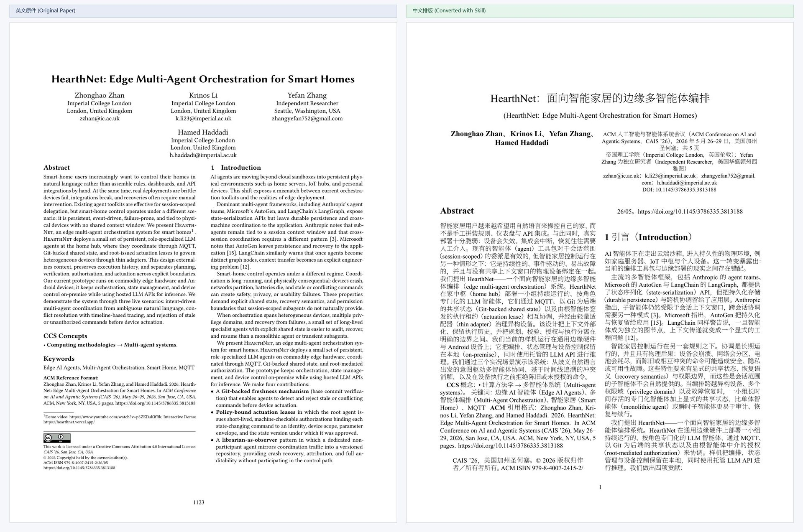
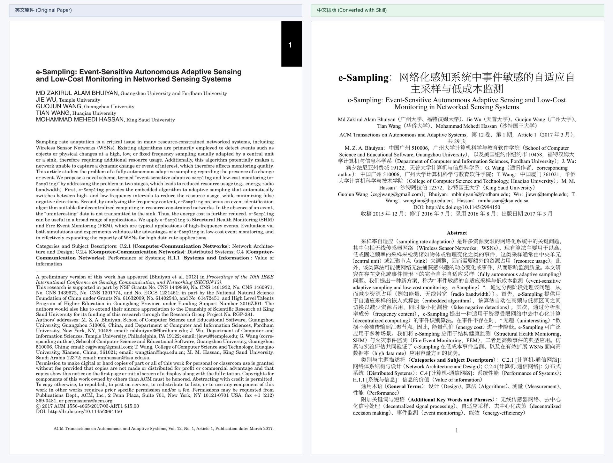
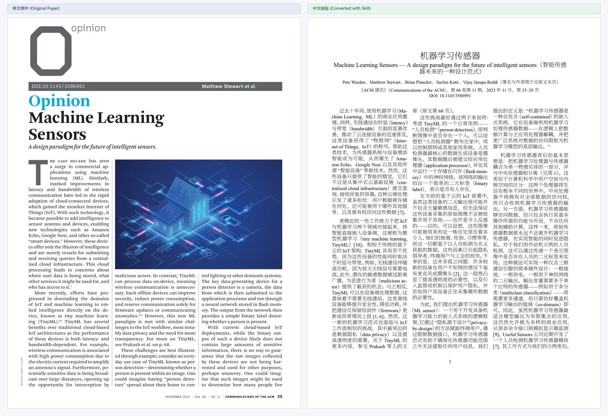
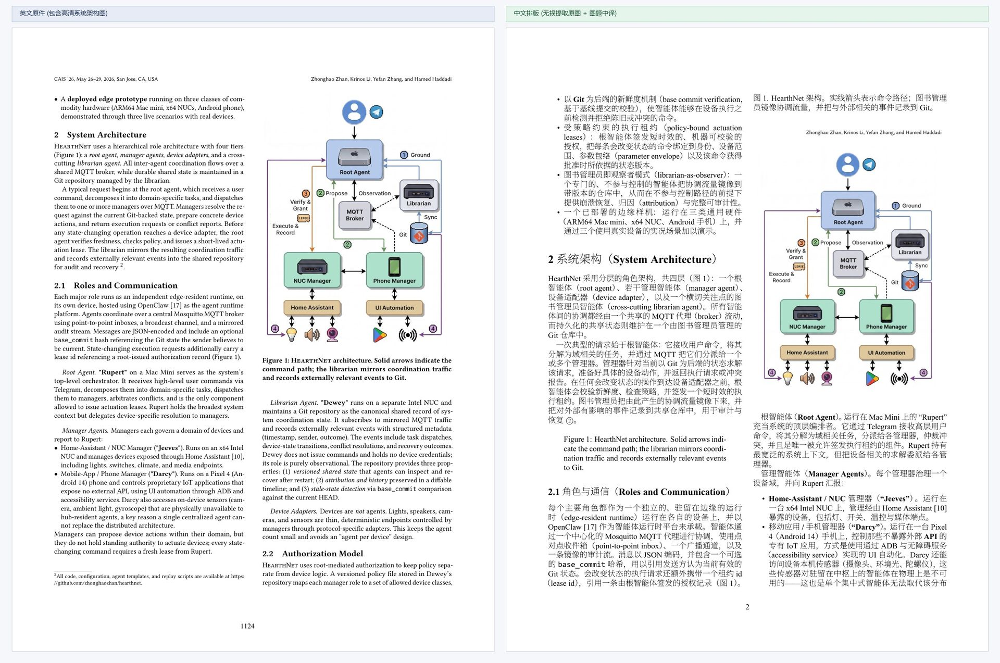
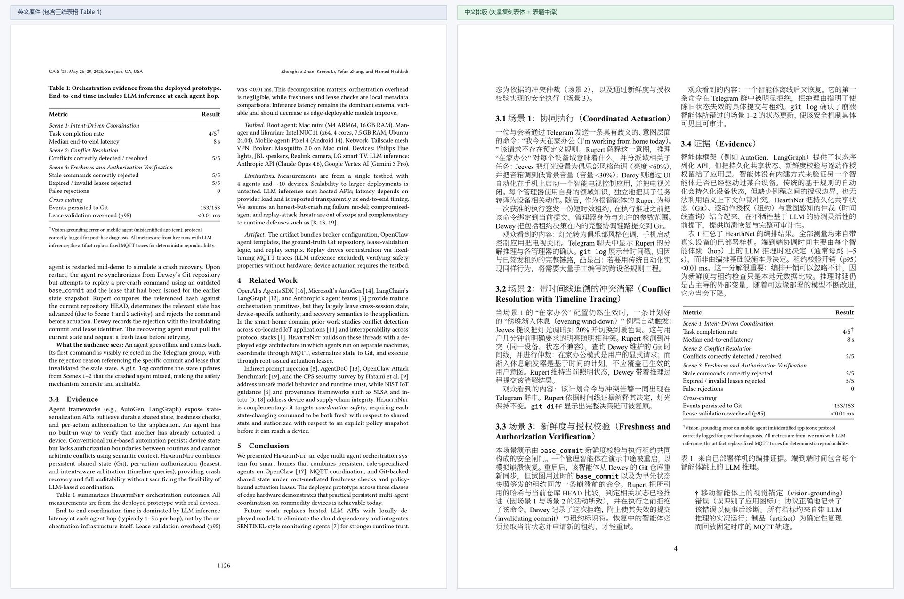

# en-zh-paper-convert — 英文论文 → 中文论文（格式保留）

> **把英文论文 PDF 转成格式保留的中文论文 PDF**：单/双/三栏、纸张尺寸与页边距逐篇照原件，插图从原件无损提取，表格矢量复刻，交付前有硬门控质检。
>
> *Format-preserving English-to-Chinese academic paper typesetter: 1/2/3-column layout matching, lossless figure extraction, vector table recreation, and strict quality gates.*

[](https://github.com/YangObscurity/en-zh-paper-convert)
[](LICENSE)
[](https://agentskills.io/specification)

本仓库是一个遵循 [agentskills.io 规范](https://agentskills.io/specification) 的 **skills 库**。skill 本体位于 [`skills/en-zh-paper-convert/`](skills/en-zh-paper-convert/)，目录名与 `SKILL.md` frontmatter 的 `name` 一致（规范硬要求）。

**目录**：[是什么](#是什么--不是什么) · [效果对比](#效果对比) · [安装](#安装) · [快速开始](#快速开始) · [输入约定](#输入约定) · [仓库结构](#仓库结构) · [依赖](#依赖) · [已知限制](#已知限制) · [规范合规](#规范合规) · [许可证与署名](#许可证与署名)

---

## 是什么 / 不是什么

| 是 | 不是 |
|---|---|
| 一条**格式保留**的论文转换流水线：版式、图、表都照原件 | 一个「翻译服务」：译文由你或你的翻译流程提供（Markdown） |
| 一套**带硬门控**的脚本：不达标就拒绝出稿，绝不静默降级 | 一个「跑完就一定对」的黑盒：版式必须**目视确认** |

**核心矛盾**：译文是新的文字流，但版式、图、表必须与原件一致。
因此默认策略是：**能复刻的绝不重排，能目视的绝不只信机器**。

**输入**：英文原件 PDF + 中文译稿 `.md` → **输出**：格式保留的中文论文 PDF。

---

## 效果对比

### 1. 双栏学术会议版式（IEEE / ACM Conference 典型）
复刻页面几何（612×792 bp）、双栏边距、标题块、作者信息、中英双语摘要与双栏正文。



### 2. 单栏期刊版式（ACM Transactions 典型）
适配非标纸张（486×720 bp）、宽边距与长篇单栏正文，标题层级与元信息逐项对齐。



### 3. 三栏杂志特刊版式（CACM 典型）
用 `multicols{3}` 支持三栏窄版式；窄栏中的长邮箱、长标识符自动注入零宽断点，避免越栏。



### 4. 插图无损提取与图题翻译
不做整页截图。原生位图直接无损取出，矢量框图通过图形簇定界后高精渲染，图题译为中文并保持原位。



### 5. 表格矢量复刻（表体保真 + 表题中译）
不手写易错位的 LaTeX 表。表体通过 `show_pdf_page` 矢量切片嵌入正文，原表英文内容与三线表排版保持矢量保真，表题译为中文。



---

## 安装

**只需把一个目录装进你的 agent**：

```
skills/en-zh-paper-convert/
```

整个目录拷到客户端的 skills 目录即可。目录名必须保持 `en-zh-paper-convert`（规范要求 `name` 与父目录名一致）。

| 客户端 | 放置位置 |
|---|---|
| VS Code（Agent Skills） | `<项目根>/.agents/skills/en-zh-paper-convert/` |
| Claude Code | `<项目根>/.claude/skills/en-zh-paper-convert/` 或 `~/.claude/skills/en-zh-paper-convert/` |
| 其他兼容客户端 | 见该客户端的 skills 发现目录；规范本身不限定位置 |

```powershell
# 1) 克隆仓库（若尚未克隆）
git clone https://github.com/YangObscurity/en-zh-paper-convert.git

# 2) 拷贝 skill 到当前项目（以 VS Code 为例）
New-Item -ItemType Directory -Path .agents\skills -Force | Out-Null
Copy-Item -Recurse -Force en-zh-paper-convert\skills\en-zh-paper-convert .agents\skills\
```

### 装完先自检

```powershell
# 1) 规范合规（可选，需要官方校验器 skills-ref；无输出 = 通过）
skills-ref validate .agents\skills\en-zh-paper-convert

# 2) 工具链就绪（必需）
python .agents\skills\en-zh-paper-convert\scripts\check_env.py
```

> **只拷 skill 目录就够了**：`scripts/`、`references/` 都在里面；工作区数据（`Paper/`、`.work/`、`out/`）会在运行时就地创建。`samples/` 是示例资料，**不需要**装进 agent。

> **首次使用**要装工具链（`.venv` + `tectonic`，约 48 MB，需联网）：`python <skill>/scripts/setup_env.py`。若本机已有 tectonic，设置环境变量 `TECTONIC_BIN` 指向它即可跳过下载。

**想先看看它的输入长什么样？** [`samples/`](samples/) 里有一篇 CC BY 4.0 的示例论文（PLOS ONE，8 页，单栏，1 表 3 图），用法见 [`samples/README.md`](samples/README.md)。

---

## 快速开始

> 环境：Windows、Python 3.11+、可联网（首次装工具链与拉 TeX 宏包）。命令均相对仓库根目录；若 skill 已拷到别处，把 `skills/en-zh-paper-convert/` 换成你的安装路径。
> 本节只给主线；各步骤的判据、列序与排错以 [`SKILL.md`](skills/en-zh-paper-convert/SKILL.md) 和 `references/` 为准。

**步骤 0：装工具链并自检**

```powershell
python skills/en-zh-paper-convert/scripts/setup_env.py
python skills/en-zh-paper-convert/scripts/check_env.py
```

**步骤 1：放入原件与译稿**（命名规则见[输入约定](#输入约定)）

```powershell
Copy-Item <你的素材>\*.pdf Paper\
Copy-Item <你的素材>\*.md  Paper\
```

**步骤 2：判版式（只是候选）**

```powershell
python skills/en-zh-paper-convert/scripts/detect_format.py Paper\<原件>.pdf
```

**步骤 3：目视确认版式（不可跳过）**
把正文页渲染出来，用眼睛看是单栏、双栏还是三栏。机器判定只是候选，版式决定必须目视确认，没有脚本能替你完成。

**步骤 4：登记版式台账（必需输入）**
编辑 `.work/format-ledger.tsv`（制表符分隔，首行为表头），为该篇补一行。台账缺该篇记录时，`runpaper.py` 会拒绝出稿。

- 关键列：第 3 列「原件版式」填 `double` / `single` / `triple` 这类可解析值；第 8 列「采用模式」填 `conf`（2 栏）/ `access`（1 栏）/ `tri`（3 栏）；第 10–12 列为纸张、页边距（**L/T/R/B**，单位 bp）、版心宽。
- **完整列序与示例行见 [`SKILL.md` §2b](skills/en-zh-paper-convert/SKILL.md)**（以代码 `runpaper.py::read_ledger()` 为准，错一位会报「台账中无 #NN 的版式记录」）。
- ⚠️ **必须用 Python 写这个 TSV**（UTF-8 无 BOM、LF）。用 PowerShell 写会得到整份 GBK 乱码，并可能悄悄吞掉制表符使整列错位。

**步骤 5：量几何（必需输入）**

```powershell
python skills/en-zh-paper-convert/scripts/detect_geometry.py Paper\<原件>.pdf --json .work\<NN>\geometry.json
```

缺几何会触发 `GATE-FAIL: geom-missing`。

**步骤 6：出稿**

```powershell
python skills/en-zh-paper-convert/scripts/runpaper.py <NN> --outdir out --geometry .work\<NN>\geometry.json
```

省略 `--mode` 时从台账取；命令行模式与台账冲突、或台账无记录，都会拒绝出稿（`exit 2`）。这是把「禁止全局套用版式」做成**代码强制**，而不是文档约定。
省略 `--geometry` 时，默认读 `.work/<NN>/geometry.json`（与步骤 5 的输出路径一致）。
产出：`out/<NN>_<stub>_中文.pdf`，末尾一行 `GATE-PASS` 或 `GATE-FAIL: <原因>`。

**步骤 7：交付前自查**

```powershell
python skills/en-zh-paper-convert/scripts/verify_delivery.py out\<产出>.pdf
```

门控过不等于正确：请**随机抽验若干页**，确认图表对不对、有没有译者痕迹、表区是不是那张表。

---

## 输入约定

| 文件 | 作用 |
|---|---|
| `Paper/<stub>.pdf` | 英文原件（**没有** `<NN>_` 前缀） |
| `Paper/<NN>_<stub>_中文.md` | 中文译稿（`<NN>` 为两位篇号，`<stub>` 为任意标识串） |
| `.work/format-ledger.tsv` | 版式台账（**必需**，见步骤 4） |
| `.work/<NN>/geometry.json` | 页面几何（**必需**，见步骤 5） |
| `Paper/<NN>.figs_override.json` | 可选，人工校准：图题不在文本层时手工指定 |
| `Paper/<NN>.figs_source_gaps.json` | 可选，人工校准：原件确实缺图时登记 |

脚本这样配对原件与译稿：从译稿名去掉 `<NN>_` 前缀和 `_中文.md` 后缀得到 `<stub>`，再去 `Paper/` 找 `<stub>.pdf`。例如：

```
Paper/Konings 等 - 2016 - Entity tracking within a Zigbee based smart home.pdf
Paper/01_Konings 等 - 2016 - Entity tracking within a Zigbee based smart home_中文.md
```

两者都要放在 `Paper/` 下，且除前缀/后缀外**必须同名**，否则报「找不到 #NN 的译稿」。若原件带额外后缀（如 `_CC-BY.pdf`、`_v2.pdf`），`runpaper.py` 会依次尝试 `stub.pdf`、`stub*.pdf`、含 stub 关键字的 PDF，找不到时列出 `Paper/` 下所有 PDF，方便你重命名。

> **`.work/` 与 `Paper/` 默认被 git 忽略**：台账、几何与人工校准文件不在版本库里。**全新 clone 必须重建**（逐篇跑步骤 2–5，含目视确认）。

---

## 仓库结构

```
<repo root>/
  README.md                         # 本文件
  LICENSE                           # MIT
  .gitignore                        # 忽略 Paper/、.work/、out/ 等
  assets/                           # 5 张效果对比图
  samples/                          # CC BY 4.0 示例论文 + 说明
  tools/
    .gitkeep                        # 本地工具链占位（tectonic 下载目录）
  skills/en-zh-paper-convert/       # ★ skill 本体（目录名 == frontmatter name）
    SKILL.md                        # 入口指引
    scripts/                        # 18 个 Python 脚本
    references/                     # 7 篇参考文档（渐进披露）
```

skill 目录保持精简：`Paper/`、`samples/` 都不放进去，所以单独拷贝 skill 目录就是一个自洽的可分发单元。

### 工作区根目录怎么解析

skill 目录（放代码）与工作区根（放 `Paper/`、`.work/`、`out/`）可以是两个不同的地方。`scripts/_workspace.py` 按以下顺序解析，**显式 `--root` 永远优先**：

1. 环境变量 `PAPER_SKILL_ROOT`
2. 从 skill 目录**向上**找最近的、含 `Paper/` 的祖先
3. 最近的、含 `.git` 的祖先
4. skill 目录自身

所以在本仓库里，`Paper/` 在仓库根，工作区根就是仓库根；单独拷走 skill 时，数据就地创建在 skill 目录。自查：

```powershell
python skills/en-zh-paper-convert/scripts/_workspace.py --show
```

`setup_env.py` 是例外：它把 `.venv/` 与 `tools/` 装在 **skill 目录内**（这是 skill 自带的工具链）。

### `scripts/` 一览

| 脚本 | 作用 |
|---|---|
| `runpaper.py` | **单篇编排**：台账门控 → 几何 → 模板 → 剥离 → 拆段 → 图表提取 → prep → 编译 → 门控 → 产出 |
| `setup_env.py` / `check_env.py` | 建 `.venv` 并下载 tectonic / 环境自检 |
| `detect_format.py` / `classify_papers.py` | 版式**候选**判定（单篇 / 批量） |
| `detect_geometry.py` | 纸张与页边距测量（单位 bp） |
| `prep.py` | Markdown → LaTeX 正文装配（图/表环境） |
| `strip_meta.py` | 剥离译者痕迹（译注、说明、自查清单） |
| `extract_figs.py` | 从原件无损提取图（原生位图直取 / 矢量定界渲染） |
| `extract_tables.py` | 表的矢量复刻（`show_pdf_page`） |
| `verify_delivery.py` | 交付件自查（字体嵌入、图表编号闭合、无译者痕迹） |
| `gate_encoding.py` / `audit_vs_ledger.py` | 编码门控 / 台账与实测一致性审计 |
| `_workspace.py` / `_backend.py` | 工作区根解析 / 执行后端（`local-tectonic`，可选 `ssh-xelatex`） |
| `_audit_*.py` | 脚本自身的编码与乱码体检 |

### `references/` 一览（渐进披露，`SKILL.md` 按需引用）

| 文件 | 何时读 |
|---|---|
| `workflow.md` | 端到端流程与逐阶段检查清单 |
| `layout-rules.md` | 版式判定、几何测量、模板选择 |
| `figures.md` / `tables.md` | 图提取与图题锚定 / 表矢量复刻 |
| `gates.md` | 门控口径与失败定位 |
| `gotchas.md` | 踩坑清单（含根因与修法） |
| `environment.md` | 环境预检、所需工具与字体 |

---

## 依赖

| 依赖 | 用途 | 安装 |
|---|---|---|
| Python 3.11+ | 全部脚本 | — |
| **PyMuPDF**（`pymupdf` / `fitz`） | PDF 解析、图提取、矢量复刻 | `setup_env.py` 装进 `.venv/` |
| **tectonic**（或 xelatex） | 编译 LaTeX | `setup_env.py` 下载 `tools/tectonic.exe` |
| **pandoc** | Markdown → LaTeX | `winget install --id JohnMacFarlane.Pandoc -e` |
| **Noto Serif SC / Noto Sans SC** | 中文字体 | Windows 自带；回退 SimSun |
| poppler（可选） | 图提取 / 审计页渲染 | 缺失时脚本回退到 PyMuPDF，无需额外安装 |

**tectonic 缓存**：tectonic 默认缓存到 `%LOCALAPPDATA%\TectonicProject`。若该目录不可写（受限/沙箱环境），`_backend.py` 会自动回落到工作区内的 `.tectonic-cache`，并从已有缓存**播种**，避免重新下载约 100 MB 的 TeX bundle。

---

## 已知限制

1. **全新 clone 必须重建台账与几何。** `.work/` 被 git 忽略，而台账（版式）与几何是必需输入，缺任一个门控都会拒绝出稿。重建 = 对每篇跑步骤 2–3（含目视确认）再跑步骤 5。
2. **首次运行需联网**：tectonic 首次编译要下载 TeX 宏包（约 100 MB），之后可加 `--only-cached` 离线编译。
3. **完全扫描件（无文本层）需要先 OCR**，否则提不出文字与图。
4. **只支持 1/2/3 栏。** 4 栏及以上无法表达，一律 `REFUSING TO BUILD` 并拒绝出稿，绝不静默降级；确需降级须显式 `--allow-layout-downgrade`，并在台账「备注」列写 `DEVIATION`。
5. **版式不能全库统一**：每篇照原件，禁止把某一模式批量套用。
6. **Windows 编码**：PowerShell 写 UTF-8 会带 BOM；脚本内容一律用 ASCII，台账用 Python 写。
7. **平台**：本地一键工具链面向 Windows（`setup_env.py` 下载的是 `tectonic.exe`）；macOS / Linux 的本地流程未做系统验证。`ssh-xelatex` 后端为可选，`references/environment.md` 标注其尚未在真实远端验证。

---

## 规范合规

本仓库按 [agentskills.io 规范](https://agentskills.io/specification) 组织：

| 规范要求 | 本仓库做法 |
|---|---|
| skill 是一个含 `SKILL.md` 的目录 | `skills/en-zh-paper-convert/SKILL.md` |
| `name` 必须与父目录名一致 | 目录名与 frontmatter `name` 均为 `en-zh-paper-convert` |
| frontmatter 含 `name`、`description`，可选 `license`、`compatibility`、`metadata`、`allowed-tools` | 均已填写 |
| 大块内容拆到 `scripts/`、`references/`，按需加载（渐进披露） | 18 个脚本、7 篇参考文档，`SKILL.md` 按需引用 |
| skill 目录自洽、可单独分发 | 示例、图片、工作区数据都在 skill 目录之外 |

校验：`skills-ref validate skills/en-zh-paper-convert`（无输出 = 通过）。

---

## 许可证与署名

- 代码与文档：**MIT**，见 [LICENSE](LICENSE)。
- `samples/` 中的示例论文为 **CC BY 4.0**，按原样再分发。署名：
  Tang D, Chen M, Huang X, Zhang G, Zeng L, Zhang G, et al. (2023) SRplot: A free online platform for data visualization and graphing. *PLOS ONE* 18(11): e0294236. <https://doi.org/10.1371/journal.pone.0294236>
- 规范：[agentskills.io/specification](https://agentskills.io/specification)
